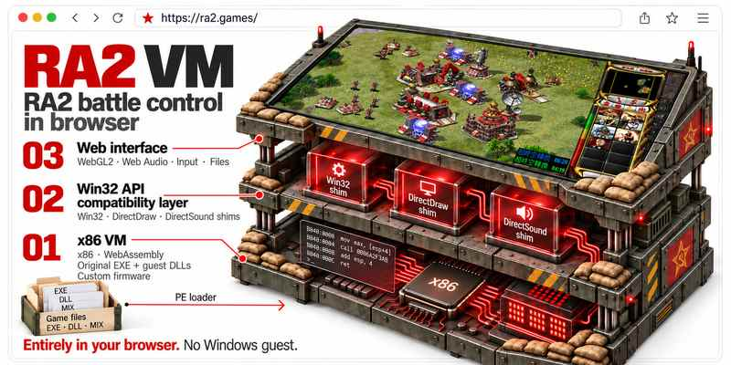
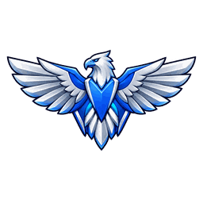
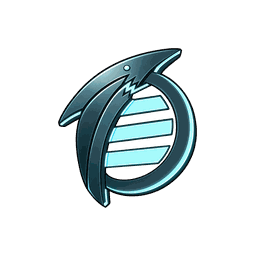
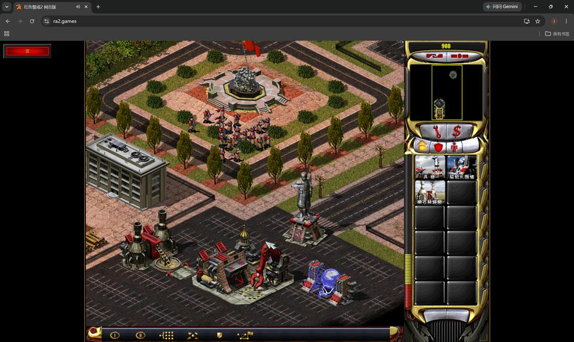
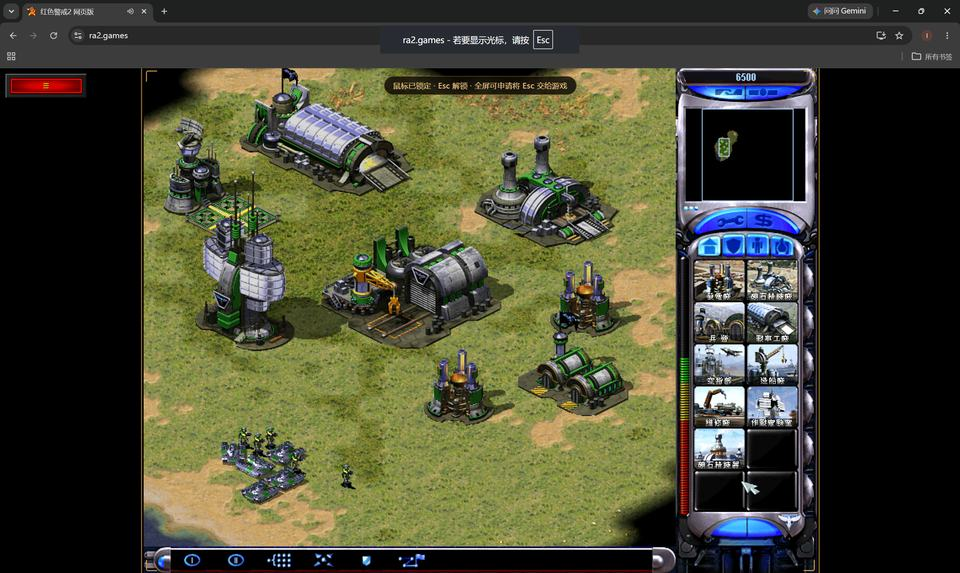
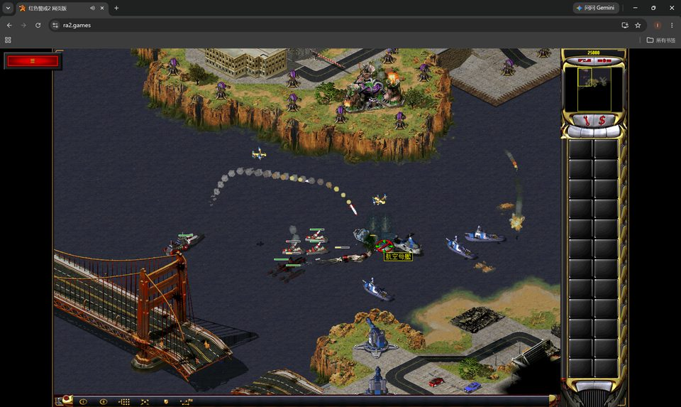
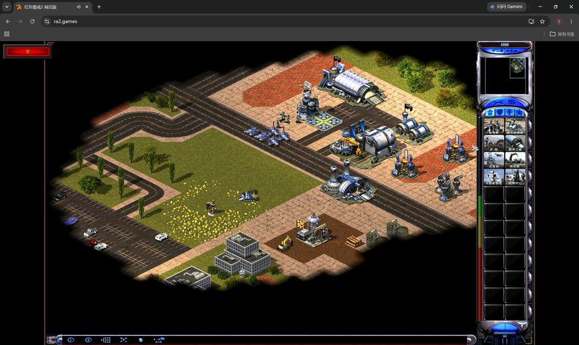

> EA has not endorsed and does not support this product.


<h1>RA2 VM</h1>

<br clear="right" />

<p align="center">
  <strong>English</strong> / <a href="README.zh-CN.md">简体中文</a>
</p>

<p align="center">
  
  <a href="docs/ARCHITECTURE.md"></a>
  <a href="package.json"></a>
  <a href="package.json"></a>
  <a href="LICENSE"></a>
</p>

<p align="center">
  
</p>

<p align="center">
  🎮<a href="https://ra2.games"><strong> https://ra2.games</strong></a>
  &nbsp;·&nbsp;
  📧 <a href="mailto:contact@ra2.games">contact@ra2.games</a>
</p>

<p align="center">
  Run <strong>Red Alert 2</strong> and <strong>Yuri's Revenge</strong> directly in your browser,
  powered by v86, custom firmware, and a Win32/DirectX compatibility layer, without starting Windows.
  <strong>Mental Omega 3.3.6</strong> uses its supplied Syringe/Ares launcher; support remains experimental.
</p>

> **Alpha:** Import locally owned game resources, choose RA2 or YR, start skirmishes,
> load saves and map packages, or play multiplayer through a WebSocket relay.

<p align="center">
  
  &nbsp;
  
  &nbsp;
  
  &nbsp;
  
</p>

## In-browser screenshots

<table align="center" width="100%" cellpadding="4" cellspacing="0">
  <tbody>
    <tr>
      <td align="center" valign="top" width="25%">
        <p><strong>RA2 · Campaign</strong></p>
        <a href="docs/assets/ra2-campaign.jpg"></a>
      </td>
      <td align="center" valign="top" width="25%">
        <p><strong>RA2 · Skirmish</strong></p>
        <a href="docs/assets/ra2-gameplay.jpg"></a>
      </td>
      <td align="center" valign="top" width="25%">
        <p><strong>YR · Campaign</strong></p>
        <a href="docs/assets/yr-campaign.jpg"></a>
      </td>
      <td align="center" valign="top" width="25%">
        <p><strong>YR · Skirmish</strong></p>
        <a href="docs/assets/yr-gameplay.jpg"></a>
      </td>
    </tr>
  </tbody>
</table>

## Start playing

### Red Alert 2 / Yuri's Revenge

1. Open the online site and prepare game resources you legally own. The resource
   screen has a **Get resources** button opening the RA2/YR purchase and MOD download links.
2. Choose **Load resources**, then **Select files…** to import an archive, or **Select folder…** to select
   a game directory. Include the original game executable. The page checks required
   resources and lists missing files.
3. In the upload dialog, choose RA2 or YR and click **Launch game**.
   Imports wait for this action; unavailable versions show missing-resource details.
4. In the original game, open **Single Player → Skirmish**, choose a map, factions,
   and computer opponents, then start.

<a id="mental-omega"></a>

### Mental Omega 3.3.6 (experimental)

Open **Load resources** to import Yuri's Revenge resources and add the MO 3.3.0 base archive and the required 3.3.6
update archive. Both can be selected together in either order, without manual
extraction. The upload headings link to the matching store or MOD package; **Get resources** also lists all links in a separate dialog.
Separate MOD packages keep original YR resources available. You can also import a complete MO installation directory directly.
Keep the supplied `Syringe.exe`, Ares and CnCNet modules together. Select a mission or map after importing; the runtime executes the original injector and its compatibility checks. See the [download and installation guide](docs/MENTAL_OMEGA_INSTALL.md).

The menu can also load browser saves directly.
The page selects English or Simplified Chinese from your browser's preferred languages. Other languages fall back to English.
Game text uses the language of the imported resources.

To investigate slow gameplay, open **Performance diagnostics…** in the game
toolbar, record for 20 seconds, then copy the report. See
[browser comparison reports](docs/GAME_PERFORMANCE.md#browser-comparison-reports).

## Play with friends

Everyone uses the same reachable relay address and room path, game version, MODs,
and maps. RA2 and YR cannot join the same match.

1. Open the online page and enable **Multiplayer** before importing resources or
   starting the game.
2. Enter the relay host and port. The room defaults to `/ra2`; add a path such as
   `127.0.0.1:15176/friends` to use another room. Everyone must use the same
   address and path. Leave the field empty only when the site already provides a
   same-origin relay.
3. Import matching resources, then open **Network** in the original game. The host
   creates a game; others join, wait for map verification, and confirm readiness
   before the host starts.

If a friend or room is missing, check the multiplayer toggle, relay address, room path, and game version.

For Docker, standalone Node, firewall, and public WSS setup, see the
[relay deployment guide](packages/relay/README.md). A static frontend build does
not include a relay server.

Connection settings are saved in the page URL; stop the game before changing
them. The member count shows other connections in the virtual LAN, while relay RTT
measures the round trip to the relay, not player-to-player latency. Interrupted matches cannot resume after a
disconnect; start a new match. See [multiplayer limitations](docs/RA2_NETWORK_RELIABILITY.md).

## Experimental AI agent / skill integration

The repository includes [ra2-strategy](.agents/skills/ra2-strategy/SKILL.md) for
economy, scouting, defense, and combat decisions, and
[ra2-battle-control](.agents/skills/ra2-battle-control/SKILL.md) for native player
operations, monitoring, and confirming results. They share one command writer
per channel through `ra2ctl`.

Start the development page and `pnpm ra2ctl serve` in separate terminals, import
your resources, and choose **Connect AI** with channel `1`. After installing and
authenticating Codex CLI or Claude Code, run one of these in another terminal:

```bash
pnpm ra2agent --agent codex --channel 1
# Or use Claude Code on the same channel instead:
pnpm ra2agent --agent claude --channel 1
```

The agent joins an existing battle by default; add `--quick-start` to allow starting
a match when none is running. Observations are limited to the current camera and
native player visibility, including fog-of-war and concealment filtering. Actions
follow native production, placement, pathfinding, and combat rules.

This support is experimental and requires RA2/YR executables that pass control-interface instruction and memory-layout checks; MO control
is not covered. See [local AI control](docs/AI_CONTROL.md) for setup, capabilities,
and verification limits.

## Compared with Chrono Divide

RA2 VM runs the original game executables; Chrono Divide recreates the RA2 engine
using web technologies. This gives the projects different compatibility scopes.

| Area | RA2 VM | Chrono Divide |
| --- | --- | --- |
| Core approach | v86 x86 emulation, custom firmware, and Win32/DirectX compatibility; runs the original EXE without booting Windows | A recreated game engine for the browser, targeting vanilla RA2 feature parity |
| Original campaigns | RA2 and YR campaigns can run | No support announced in the reviewed official material |
| Yuri's Revenge | Supported, including its original executable | Full expansion support not announced; selected YR conveniences are implemented |
| Mental Omega | MO 3.3.6 through supplied Syringe/Ares; experimental native startup | No MO support announced |
| Waypoint orders | Uses the original game's command logic | Waypoint command queues supported |
| Looping waypoints | Supported | Not confirmed in the reviewed official material |
| Save / load | RA2/YR saves; MO save compatibility requires separate validation | Replays supported; original-game save compatibility not confirmed |
| Multiplayer | Original Network menu over a WebSocket relay; matching versions and resources required | Browser multiplayer with Quick Match and ranked ladders |
| Replays | No browser replay feature currently provided | Supported |
| AI agent / skill integration | Experimental RA2/YR strategy and battle-control skills, with a dedicated agent launcher | Game API and a bot development sample; agent skill packaging not confirmed |

Scope: Chrono Divide's official About/Features and `patch-notes.html`, through
v0.84.0 (3 September 2026), reviewed on 15 October 2026; community forks are excluded.
AI API reference: Chrono Divide `game-api-playground`, `master`, `README.md`.
“Not confirmed” does not mean unsupported.
Running campaigns does not establish full campaign completion. MO support remains experimental; startup validation does not establish full campaign or multiplayer compatibility. See the
[MO guide](docs/MENTAL_OMEGA_INSTALL.md). For RA2 VM's design and multiplayer scope,
see [architecture](docs/ARCHITECTURE.md) and
[multiplayer limitations](docs/RA2_NETWORK_RELIABILITY.md).

## Running and developing

Internal work uses `dev`, which is not pushed to GitHub. External contributions
target `main`. Use Node.js and the pnpm version specified in `package.json`; the
project does not pin a Node version range. The first CPU build also requires Rust
with the `wasm32-unknown-unknown` target, clang, lld, make, git and Python 3;
see [CPU build instructions](scripts/vm/README.md).

```bash
pnpm install --frozen-lockfile
pnpm run dev
```

Open the HTTPS address printed in the terminal and select a local game directory
or archive. Include the original `game.exe` (RA2) or `gamemd.exe` (YR). The app
preserves that executable during import and cache restoration; it does not
download a replacement. Original game executables and installation archives are not included, and public
tests do not require them.

Imports are saved in this browser after extraction finishes, including incomplete
resource sets and separate MO packages. Refresh restores the resource selection;
choose a version in Load resources and click Launch game to start. Clear cache
in the upload dialog removes imported resources while
keeping saves and custom maps. Storage errors are shown in the upload dialog.

```bash
pnpm run check             # Types, asset-free unit/synthetic VM tests, production build
pnpm run build             # Static frontend in dist/
pnpm run preview           # Preview the build
pnpm run server:relay:dev  # Watch mode; restarts disconnect existing clients
```

Locally owned resources can be placed in the ignored `game/ra2/` directory. See
the [testing guide](docs/TESTING.md).

## Documentation and contributions

**For players:** [Local AI control](docs/AI_CONTROL.md) ·
[Game performance](docs/GAME_PERFORMANCE.md) ·
[Multiplayer limitations](docs/RA2_NETWORK_RELIABILITY.md)

**For contributors:** [Architecture](docs/ARCHITECTURE.md) ·
[Contributing](CONTRIBUTING.md) · [Testing and CI](docs/TESTING.md) ·
[Real-game CI](docs/REAL_GAME_CI.md) · [Documentation index](docs/README.md) ·
[Relay protocol](packages/relay/RELAY_PROTOCOL.md) ·
[Third-party notices](docs/THIRD_PARTY.md)

## Runtime scope and compatibility

> **Project scope:** This project provides a browser runtime for user-supplied games. It provides no cracking, key generation, fabricated authentication results, or bypass of the original program's protection checks, and distributes no game installation files with its source. Import a complete hard-drive installation that you legally own; installation data and authorization requirements imposed by the original program still apply.

> **Compatibility boundary:** The runtime includes x86 emulation, a Win32/DirectX compatibility layer, and runtime memory adaptations. Memory adaptations provide AI control, quick startup, and game performance optimizations; they are not used to rewrite gameplay rules. AI actions still use native command handling and rule checks. Adaptations adjust parts of startup, waiting, and network timing, so execution flow is not entirely unchanged. Your source installation files are not rewritten, the original program's protection checks are not skipped, and compatibility with every version is not guaranteed.

> **RA2 / YR startup:** Import a complete installation folder or archive. A supplied launcher/configuration pair (`ra2.exe` / `ra2.lcf` for RA2, `ra2md.exe` / `ra2md.lcf` for YR) selects native launcher execution. When both are absent, the runtime attempts the game executable directly. Partial pairs and read failures are errors. `Conquer.dat` / `ConquerMD.dat` are imported when present; the original program decides how to handle their absence. Versions are not selected by an EXE hash allowlist; failed native checks or unsupported behavior do not trigger an alternate route around the failure. Mental Omega runs the supplied Syringe/Ares stack and retains its native compatibility decisions. See [startup boundaries](docs/ARCHITECTURE.md#native-launcher-and-installation-boundary).

## License

Production distributions include [third-party notices and source materials](public/licenses/index.html).

Original project code is **GPL-3.0-or-later**; see [LICENSE](LICENSE). You may
use, modify, and distribute it under GPL version 3 or any later version. The
software comes without warranty. Third-party code, dependencies, and game assets
retain their own licenses and ownership; see
[third-party notices](docs/THIRD_PARTY.md).
