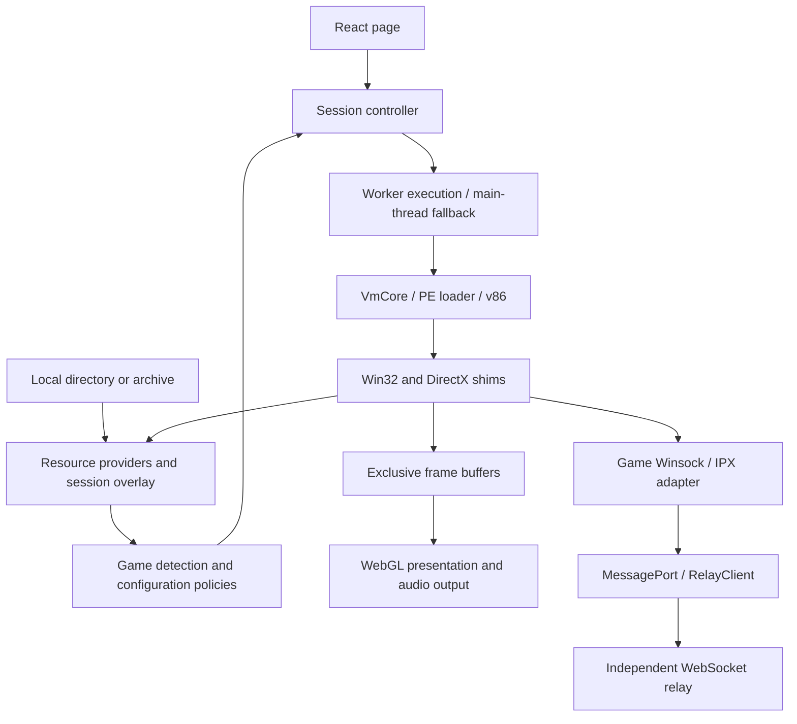

# Architecture

Design and refactoring must follow [Architecture requirements](ARCHITECTURE_REQUIREMENTS.md). This guide describes current modules and execution data flow.

RA2 VM executes original x86 programs inside the browser using v86. Custom firmware, a PE loader, and Win32/DirectX compatibility layers supply the environment required by the games. It does not boot Windows or rewrite game rules. RA2 and YR use their own version-validated executables and policies. The generic WebSocket relay is an independent workspace package.

## Execution and data flow

Players select resources before the application detects bootable games. Every newly imported package requires explicit player selection, including single-target imports. The upload dialog owns version selection and launch, retaining unavailable targets as disabled cards. Importing resources does not add version buttons to the homepage. Game-specific configuration is constructed at the main-thread and Worker composition roots. Cross-thread communication carries only data, ports, and buffers with explicit ownership handoff, never closures or shared guest memory.

## Module boundaries

| Module                        | Responsibility                                                              | Boundary                                                                         |
| ----------------------------- | --------------------------------------------------------------------------- | -------------------------------------------------------------------------------- |
| `src/resources/`              | File contracts, providers, overlays, completeness detection                 | No browser-storage or VM dependency                                              |
| `src/platform/browser/files/` | Directory access, HTTP, IndexedDB                                           | No game-version or guest-ABI decisions                                           |
| `src/games/`                  | Game manifests, ABI, resource policies, version patches, network adaptation | Fixed game addresses belong only here                                            |
| `src/vm86/`                   | Firmware, PE, Win32/DirectX mechanisms                                      | No game, browser, or UI dependency                                               |
| `src/utils/`                  | Generic hashing, asynchronous tasks, archive extraction                     | No dependency on other src business modules; no session or game-policy ownership |
| `src/adapter/`                | VM execution adaptation, Worker bridges, audio adaptation                   | Game behavior is injected through configuration                                  |
| `src/app/session/`            | Session startup, replacement, failure, and destruction                      | Owns VM and surrounding-task lifecycles                                          |
| `src/graphics/`               | Frame presentation, scheduling, and buffer release                          | Does not alter guest simulation speed                                            |
| `src/ui/`                     | One React tree, user interaction, status presentation                       | Frequent data stays out of React state                                           |
| `packages/relay/`             | Generic binary protocol, client, server                                     | No game/application imports                                                      |

`games/vmConfiguration.ts` registers runtime factories for the selected game. RA2/YR explicitly reuse `games/shared/vmConfiguration.ts`, which composes resource policies and shim factories. `games/source.ts` describes target games and file sources. `VmCore` consumes injected capabilities without selecting extension caches or import ABI by game name.

Callers of pure providers import the relevant module directly, avoiding barrel imports that bring in browser code and the entire shim. `utils` contains only foundational capabilities without game policies; callers import individual files, with no barrel entry point. Independence from a particular game does not imply utility ownership: frame caches belong to presentation, resource prefetching depends on provider contracts, and audio has a platform lifecycle.

Generic extraction lives in `utils/archive/`: ZIP reading, 7z/rar extraction, NSIS parsing, LZMA, and their Workers. Extraction tasks own Worker cancellation and destruction. Third-party code, licenses, and attribution stay with the module. Game allowlists, startup-layer partitioning, and YR base-resource dependencies live in `games/archivePolicy.ts`. Adapter loading entry points execute the layered plan. Serializable `directoryRules` inject taunt-audio placement rules shared by browser and CI.

Windows path normalization lives in `utils/windowsPath.ts` and is reused by guest path entry points. `utils/memoryDiff.ts` only compares byte snapshots; adapter retains recording state and cross-thread result contracts.

Assign responsibilities by reason for change: game formats, resource precedence, and compatibility rules belong to `games`; VM/host connectivity belongs to `adapter`; session startup and destruction belong to `app/session`. Composition entry points may reference concrete implementations but must not define game rules themselves. New games must register their own policies and factories, with no implicit RA2/YR fallback.

The session lifecycle interface in `app/session/runtime.ts` requires only startup and destruction. The controller preserves the caller's concrete type without depending on adapter input, debug, or map interfaces. Its optional synchronous `beforeStart` callback runs after acquiring the current shell and before startup; preparation failures use the same shell cleanup as startup failures. The page uses it to record confirmed execution mode for startup diagnostics. Status/event contracts live in `app/session/runtimeEvents.ts`; adapter and UI import them directly, without a reverse dependency from sessions to adapter.

## Resources and persistence

The resource picker owns pending imports and cancellable MOD package extraction.
The Load resources modal combines original-game and MOD imports; a separate Get
resources modal owns purchase/download links. Both remain in the same React tree.
`games/resourceAvailability.ts` derives each game's missing files and shared-EXE
MOD precedence. `games/mentalOmega/installation.ts` classifies MO package roles and
assembles original YR files, base contents, patch overrides, and an optional final
language MIX layer into an independent
session provider. Required original files remain authoritative; package selection
order never decides patch precedence. Neither package layer mutates the original
provider. The installer commits a selected batch only after every archive succeeds;
failed/canceled reads retain the previous selection. Import persistence records preparation state without declaring executable compatibility;
launch still requires the complete manifest and executable validation. The UI owns dialog state;
Workers, archive extraction and game-specific rules stay outside React.

`GameSource.sessionFiles` carries user-selected launch settings separately from
custom-map imports. Adapter overlays these files on the source in both execution
modes; Worker messages receive independent byte copies. Mental Omega's game module
reads its installation catalogue and produces launch files only after menu selection.
The React menu request is cancelled with the page lifecycle; restoring resources
does not itself choose a mission or start its VM.

`platform/browser/files/importedResources.ts` owns the atomic IndexedDB snapshot
for original resources and separately labeled add-on layers. It commits only after
full extraction, preserves empty files and subdirectories, and restores Blob
handles with lazy content/range reads. Importing does not require launching a VM.
The picker restores preparation state and always requires explicit launch; legacy
complete game caches remain readable. Clearing resources removes both import
formats while retaining custom maps and the independent save writeback database.
Switching resources returns to the picker without deleting imported packages.
Quota errors retain the previous committed snapshot and remain visible in the dialog.

`platform/browser/files/sessionFiles.ts` owns the browser implementation for extracted files and IndexedDB writeback. `adapter/gameZip.ts` selects parsers and composes results; it no longer defines persistence providers. Pure memory providers remain in `resources/providers/memory.ts`.

File interfaces distinguish unknown, missing, zero-byte, and failed reads. A visible directory entry does not imply its bytes have been extracted. Reads pending background work wait for the provider instead of pretending the file is missing. Range reads preserve actual lengths and offsets. Provider-backed sparse files bypass guest fast mirrors. Missing or incomplete pages return a read fault without modifying the destination or advancing the file position; an incomplete provider response is never mounted as a complete page.

Runtime settings do not overwrite original game files, executables, or cross-session caches. Shadowed overlay writes retain independent session snapshots, including empty files, with priority over both parent and original overlay reads. Reopening an INI therefore observes guest changes while the imported configuration remains intact. Other writes, including saves, continue to the parent provider for persistence. Static files may reuse snapshots; writable INI/SAV content is reread according to policy. Replacing a provider invalidates affected caches. Zero-byte files participate in save/restore and must not disappear during cache cleanup.

The OLE shim serializes native `IPersistStream` objects through reusable guest callback slots. Save, load, and registered class creation share the scheduler-aware callback lifetime; per-object code allocation would exhaust the dynamic stub arena. Structured storage uses the project's `SGBYSTG1` container, with stream data followed by length-prefixed property metadata. This is not the Windows compound-file format. Older containers without metadata remain parseable, but RA2 saves produced while native object serialization was disabled omit game state and cannot be repaired into complete saves. RA2 and YR both execute native serialization; no profile can replace it with a success-only stub. Asset-free persistence regressions execute actual x86 callbacks and reopen serialized metadata in a fresh shim.

Archives retain startup-required and background partitions internally. Resource import waits for full extraction before enabling launch and publishing a snapshot; background extraction failures remain visible. Saving succeeds only after the IndexedDB transaction completes. Quota exhaustion cannot be reported as a restorable cache. Exclusive copies returned by cache backends may be handed off; guest WASM memory and shared executable caches must never be transferred. These contracts are covered by provider, archive-layer, and cache tests listed in [Testing](TESTING.md).

## Guest compatibility and version policies

The PE loader parses images/imports. Import stubs dispatch guest calls to shims, clean arguments according to each game's ABI, and return. Unimplemented calls must not default to success. Games may share generic mechanisms, but version addresses, signatures, and patches belong separately to RA2/YR. Write patches only after every target signature passes. Unknown instruction layouts retain original behavior or explicitly reject unsupported features.

RA2/YR link Bink imports directly to the bundled guest DLL before entering the executable, including sound-backend function pointers. The DLL owns initialization, movie handles, decoding, timing, and playback threads; the VM supplies the imported Win32/DirectSound services. There are no host-generated movie handles, forced completion, per-movie thread pins, forced synchronous I/O flags, or fixed frame-time patches. Required DLLs that cannot be loaded fail explicitly. Range-backed movie reads retain the normal provider error semantics.

Native addresses use capability detection: generic PE section inspection supplies bounds and unique signature matching; game policies resolve and cross-check operands, native control flow and ABI against the loaded image. `GameRuntimeHooks.resolve` creates session-owned hooks before patches; `VmCore` uses them for startup, speed writes, input guards and networking in both execution modes. Optional patches have independent evidence and no fixed-address fallback. See [Adaptive executables](ADAPTIVE_EXECUTABLES.md) for the resolution contract and corpus tests, and [Native performance](GAME_PERFORMANCE.md#automatic-detection-and-evidence) for read-only counters.

Startup-page and direct-battlefield entry use one-shot guest hooks while retaining native initialization. Multiplayer startup sets an initial target from the room speed; subsequent performance reports, Timing, synchronization windows, and acknowledgments are handled by the original program. Never bypass game logic using fabricated input, acknowledgments, or clocks. Version-specific evidence lives in source, behavioral tests, [Launch behavior](RA2_COMMAND_LINE_AND_SPAWNER.md), and [Network reliability](RA2_NETWORK_RELIABILITY.md); this architecture guide does not duplicate address inventories.

RA2 and YR remain separate engines. A single gamemd loading original RA2 resources is not a supported promise. Such conversion involves game logic and patches; filename mapping alone does not establish compatibility. RepairRate diagnostics are read-only: host input does not replace zero, negative or nonfinite rules values with a default. The former mouse-message workaround had no established cause for the observed zero and was removed; native failures remain visible.

DirectPlay enumeration returns the reserved guest callback frame to the caller so its staging allocations can follow that frame's lifetime. Before another enumeration, the shim reclaims only buffers whose callback owner flag is clear; guest return tails and thread exit clear that flag. Nested or concurrent enumerations retain their own descriptors, names, and timeout pointers. An unrelated callback reusing a slot may delay collection, but cannot cause early release. Failed allocation or bridge generation rolls back unpublished buffers and reservations. Remaining staging is bounded by the callback-slot count and ends with the VM heap.

Guest callback slots can reserve a caller-sized scratch tail; bridge generation checks its code against that boundary before publication. DirectDraw display-mode enumeration stores its descriptor there, keeping each active callback's mode snapshot stable across nested mode changes without permanent heap staging. The existing callback owner and return/exit paths govern both code and scratch lifetime.

Date and time formatting validate only the SYSTEMTIME fields used by the respective API. Date validation checks actual month lengths and leap years before deriving the weekday; unused time fields do not invalidate a date, and unused date fields do not invalidate a time.

## Scheduling, presentation, and ownership

Threads, events, and mutexes allocate guest-visible handles from one monotonically increasing sequence without reserved launcher identities. Closing a handle or recycling a thread's scheduler slot never makes that identity available to another wait object.

Worker execution is one guest path; main-thread fallback uses identical game policies and file semantics. `platform/browser/emulator.ts` wraps v86 browser adaptation. When the upstream interface matches, Workers use an in-thread MessageChannel scheduler while retaining original positive-wait durations. Otherwise, upstream scheduling remains in place. The main thread keeps its own scheduler. Adaptation does not change the guest clock or PIT frequency.

DirectDraw boundaries produce frames, and exclusive frame buffers pass to presentation. The presenter selects the newest frame and coalesces browser drawing. Simulation FPS, submitted-frame FPS, and rAF FPS are distinct metrics; discarding obsolete visuals must not change simulation results. Controllers own audio, input, WebGL objects, and frequent messages, without propagating them frame by frame through React state. Experimental upscaling loads lazily through development entry points; production entry points do not load ORT or experimental model Workers.

Audio output observations distinguish the played position from the committed render position. DirectSound returns both cursors, including its generated x86 cache; locking from the write cursor does not seek playback. Web Audio uses output timestamps when available, with reported output latency as fallback. Worklet completion is reported at the final non-looping quantum, so short streams can stop and replay without waiting for a periodic cursor message. Worker feedback ownership and scheduling limits are described in [Worker](WORKER.md#audio-feedback).

The session controller handles normal exit, reopening, and failure cleanup. Worker termination also closes network proxies and ports. Timers, listeners, pending RPCs, and buffers all have disposal paths. Queued callbacks become invalid after destruction; asynchronous results must not revive old sessions or overwrite new ones. See [Worker](WORKER.md) and [React boundaries](REACT_UI.md).

## Multiplayer and the independent relay

Local AI control ships its CLI, loopback HTTP/WebSocket router and wire contracts in the self-contained `.agents/skills/ra2-battle-control` workspace package (`@ra2vm/control`). The browser imports its Node-free `protocol` entry and game policies share its serializable `contracts`; the skill never imports application source. Standalone installs use its own dependency manifest and lockfile. Control uses this router, page-owned browser connection and VM-shell RPC. `app/session/applicationControl.ts` routes application status and deduplicated quick-start requests through injected lifecycle operations, retaining the channel across VM replacement. The page owns resource selection and reuses the existing validated game startup hook; the VM supplies native menu/readiness observations. Game modules restrict observations to the native camera and local visibility, reject hidden target IDs, and dispatch native camera, sidebar actions or events through a validated guest mailbox; neither the generic VM nor multiplayer relay interprets AI commands. Game-owned, version-validated terminal observers retain local battle results before native teardown; `VmCore` forwards the serializable result through the same Worker/main API, and the CLI consumes it without interpreting scores or memory. See [AI control](AI_CONTROL.md) for channel semantics, native evidence and verification boundaries.

Current-view image requests are application capabilities, injected by the page rather than implemented in game-memory readers. `graphics/presentedFrameCapture.ts` copies only requested presented pixels before frame-pool reuse; the browser encoder bounds image size and the CLI writes the image locally. Presentation disposal rejects pending captures, and application routing rejects results from replaced page generations. No image pixels enter React state or reveal hidden object metadata.

Game layers convert Winsock/IPX datagrams to virtual addresses and ports. The relay routes binary datagrams by room without interpreting game events, units, or resources. Rooms derive from URL paths; address selection and game metadata belong to callers. Main-thread `RelayClient` owns the WebSocket; Workers send/receive through a dedicated MessagePort.

The port bridge combines already-pending data and acknowledges batches. WebSocket retains each game datagram's message boundary; batching adds no waiting timer. Port ACKs reclaim bridge capacity only. WebSocket backlog is still checked before actual sending. Limit violations and connection closure retain session-termination semantics, with no automatic reconnect, replay of old commands, or match resumption.

`relay-package/client` does not load the Node server; the server does not depend on browsers. The package maintains the sole [wire protocol](../packages/relay/RELAY_PROTOCOL.md) and builds/deploys independently. The application supplies game adaptation; the generic package supplies connections, heartbeats, rate limiting, backpressure, and close cleanup.

`packages/relay/src/network/relayWire.ts` is the current multiplayer wire format. `src/vm86/shim/dplayWire.ts` defines a separate DirectPlay session/player protocol, carried by `dplayTransport` only when the guest creates a DirectPlay session. Its browser default still uses the historical `/game` path, which is not mounted by Vite. These protocols have different types, codecs, and semantics; do not merge them or reuse each other's frames. The relay package independently owns `relayWire` byte layout, and the generic shim does not depend on it.

## Verification design

`tests/basic/architecture/dependencies.test.ts` automatically checks dependency boundaries. Pure logic and synthetic VM tests do not read game assets. Instruction fixtures verify ABI and patch behavior inside real v86. Separate real-game tests use hash-validated assets to verify native startup, frames, player state, and command execution on both clients.

Public CI and asset-enabled CI are separate: the former accepts contribution checks in isolated environments, while the latter runs reviewed code only. Performance conclusions use native frame counters and measured time in the same scenario. Target FPS, microbenchmarks, and passing short matches cannot establish long-match stability. See [Testing](TESTING.md) and [Real-game CI](REAL_GAME_CI.md) for entry points and requirements.

## Native launcher and installation boundary

RA2/YR select a startup route from the supplied installation, without storing
sample EXE hashes or maintaining a version whitelist. A nonempty PE32 launcher
and its nonempty configuration select native launcher execution. When both are
absent, the game EXE is attempted directly; a partial installation or failed
read is an error, not a reason to retry another route. Admission is not proof of
compatibility, authenticity, ownership or authorization. Native checks remain
active, and unsupported guest behavior fails normally.

The virtual registry stores a session-owned tree in `vm86/registry.ts`; each shim
owns and disposes its own handle table. Launcher and child processes share keys
and typed value bytes through the session kernel, including explicitly created
empty keys. Independent sessions share no registry contents. Opening a missing
key returns `ERROR_FILE_NOT_FOUND` and never creates it. Missing installation
paths, installer markers and credentials have no generated defaults. Guest
creation and writes are the only sources of non-root keys and values.

Value queries preserve type, zero-byte data, size-only requests and buffer limits.
Enumeration and metadata describe actual children and values; deletion marks old
handles invalid rather than making them refer to a recreated key. Handle access
masks constrain value reads/writes and enumeration. The virtual hives have an
unrestricted default ACL and remain in memory only; they do not import host
registry data. Custom security attributes/descriptors, alternate WOW64 views,
registry links and backup/restore options fail as unsupported. HKCR and the other
supported roots are independent virtual trees, without Windows' merged class
view. This is a bounded registry implementation, not a complete Windows security
or installation model. Narrow names use the same GBK code page as guest strings;
the reusable encoder is in `utils/encoding/gbk.ts`.

For the launcher route, the supplied launcher executes unchanged in a separate v86
instance. Its real `CreateProcessA` call starts the selected game in another guest
address space. The adapter owns both cores; the generic session kernel in
`vm86/processKernel.ts` owns process identities, inherited handles, named events
and mutexes, shared mappings, thread messages, and registry writes. No operating
system process is created on the host. The same path runs in the browser Worker
and main-thread fallback. A canceled bootstrap rejects its pending startup and
destroys both cores; failure in the launcher remains a failure of the session.

The launcher reads and processes the user's installation data itself. The project
supplies no replacement payload, forced verification result, generated Serial,
launcher sentinel, or automatically downloaded executable. Registry values remain
missing unless explicitly written. Communication success does not establish that
an installation is licensed or that its supplied executables are unmodified.
RA2 no longer substitutes launcher synchronization objects or skips XWIS imports.
Unsupported imports fail explicitly. The RA2 launcher route uses the user-supplied
`ra2.exe` and `ra2.lcf` through the same generic process kernel. `Conquer.dat` is imported when present but is not a host-side prerequisite;
the unchanged launcher decides how to handle its absence and performs its own checks.
The launcher and game retain their original validation code; no installer
registry marker is prepopulated by the RA2 profile.

This is a bounded bootstrap implementation, not a complete Windows process system.
Only the configured game child can be created, once; unsupported creation flags,
custom environments, security attributes, and working directories fail explicitly.
Process and primary-thread completion remain distinct. The supported mappings are
pagefile-backed, bounded to 64 MiB each, with inherited handles and independent
per-process views. Writes become visible at guest OS synchronization boundaries;
lock-free concurrent shared-memory algorithms are not supported. Named object
matching is case-sensitive. Missing message queues, invalid handles, incompatible
object types and insufficient object access fail rather than succeeding silently.

Original startup configuration is mounted at the virtual installation path in a
session overlay. The source installation is never rewritten. Game policies select
filenames, executable structure and resource requirements; the generic kernel has
no game filenames, fixed game addresses or handshake payloads.

The generic debugger relationship is owned by the process kernel and driven by
VmCore. Debug events retain suspension until continuation; event handles are
independent from process-creation handles. `IsDebuggerPresent` reports the live
debuggee relationship, including during suspended creation; the debugger owner
and unrelated processes remain distinct. Closing a process handle does not detach
a debugger. Process exit or session disposal clears presence. Host diagnostics
alone never create a guest debugger. Cross-process reads/writes operate on
actual guest memory, and thread contexts come from firmware exception frames.
The CPU's maintained source patch provides actual TF/#DB single-step execution;
see [CPU build instructions](../scripts/vm/README.md). Firmware prevents PIT
switching while restoring a debugger-stopped context. Hardware IRQs and voluntary
thread switches run in x86 TSS tasks on private firmware stacks, preserving
transient program data below ESP. Per-thread common contexts occupy
`0x260000–0x260fff`, with kernel stacks below `0x274000`. Unsupported context groups,
creation modes and debugger-declined exceptions fail explicitly. Guest SEH
dispatch is not implemented.

The shim receives the actual guest RAM limit. DLLs whose preferred image base
does not fit must use their supplied relocation table or fail explicitly.
Repeated library loads reuse the existing mapping without rereading the source.
An initializer returning FALSE stops loading; it never fabricates a module handle.
`VirtualAlloc` aligns newly reserved bases to allocation granularity, commits page
ranges without clearing already committed data, and retains unused free-block
prefixes and suffixes. These are shared runtime mechanisms, not game-version rules.

Mental Omega uses its supplied Syringe/Ares/CnCNet stack through the restricted
native debugger contract. Its first campaign and Standard skirmish have passed
native simulation and input checks with supplied resources. Browser folder import
and skirmish startup have passed in Worker and main-thread execution; other
compatibility claims need their own evidence. See
[Mental Omega validation](MENTAL_OMEGA_INSTALL.md#native-startup-validation).

Acceptance covers actual launcher IPC, native main-menu presentation, short
skirmish simulation advancement and both browser execution modes. Missing-file
regressions and asset-free handle, mapping, message and cancellation tests check
failure behavior. These tests do not establish long matches, campaign completion,
LAN authentication, or universal legacy-version compatibility.

Game resource policy never downloads missing installation DLLs from the web server.
Required preload failures ask for a complete user-supplied installation. Vite does not serve local game installations. Browser regressions import local
folders through the player file picker; Workers receive directory handles or
on-demand file ports, never a development HTTP provider.
